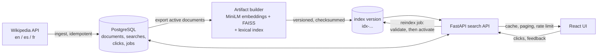

# PolySearch

A multilingual semantic search engine for Wikipedia. Type a query in English, Spanish or French
and find articles in the other languages, without translating anything first.

*"cambio climático"* returns *Changement climatique* (French) and *Climate change* (English) at
ranks 1 and 2.

> **Status and honesty notes.** Everything below is measured on a **constructed** benchmark
> (100 queries built from Wikipedia interlanguage links, not real user judgements) and on one
> developer machine. Nothing is deployed yet. See [Limitations](#limitations).

## What it does

- **Cross-language retrieval** over about 5.7k Wikipedia articles (en, es, fr) using a
  multilingual sentence encoder and exact vector search.
- **Three search modes:** `dense` (meaning), `lexical` (character n-gram keywords) and `hybrid`
  (both, fused with reciprocal rank fusion). The default is chosen from benchmark evidence.
- **A real product around it:** cached and paginated results, autocomplete, click and relevance
  feedback, privacy-preserving analytics, a React interface, and rate limiting.
- **Safe re-indexing:** a background job builds, validates and atomically activates a new index
  version; the old one keeps serving until the new one passes every check.
- **Reproducible:** locked dependencies, Docker Compose, versioned data and artifacts, and CI.

## Results

All numbers come from files in this repository and are reproducible with the commands below.

**Retrieval quality**, benchmark v1 (100 queries, 200 relevant documents, cross-language only,
5,735-document corpus; [`benchmark/v1/results/report.md`](benchmark/v1/results/report.md)):

| Method | MRR@10 | Recall@10 | nDCG@10 |
|---|---|---|---|
| Lexical (char n-gram TF-IDF) | 0.7484 | 0.8100 | 0.7238 |
| **Dense** (MiniLM, **default**) | **0.9400** | 0.9500 | **0.9374** |
| Hybrid (RRF) | 0.9100 | **0.9650** | 0.8981 |

Dense won on MRR@10 and nDCG@10, so it is the default; hybrid has slightly higher Recall@10 but
costs about 3x the search time. 29 of the 100 queries contain the target article's title; on the
other 71 dense scores MRR@10 0.9225. With 100 queries, differences of a few points are not
statistically meaningful.

**Search-core latency** (one process, sequential, Apple M4, CPU; encoder + vector search + fusion
only): dense median 9.1 ms (p95 11.3), hybrid median 25.6 ms (p95 29.5). Method and conditions
are in [`benchmark/v1/results/latency.json`](benchmark/v1/results/latency.json).

**End-to-end load check** against the Docker stack (one uvicorn worker, same machine, 100 requests
per phase): median 43 ms uncached / 10 ms cache hit with one request in flight; 571 ms / 303 ms at
20 concurrent; 1.5 s / 0.85 s at 50 concurrent; no errors; a deliberate burst got `429` responses
with `Retry-After`. Throughput stays near 30 requests/s uncached, so latency grows with
concurrency. This is a bounded engineering check, not a capacity claim; see
[`docs/load_check.md`](docs/load_check.md).

## How it works



1. **Ingest:** a MediaWiki connector (HTTPS, allow-listed hosts, bounded retries) stores each
   article with its canonical URL and revision. Re-runs update only changed articles.
2. **Build an index version:** each article becomes one vector (title plus lead summary) from the
   pinned multilingual MiniLM encoder. Vectors go into one exact FAISS index per language; a
   character n-gram index is built alongside. Files are checksummed under an immutable version name.
3. **Search:** the query is encoded once, searched in each requested target language, optionally
   fused with the keyword ranking, and the top 100 results are stored so paging is stable.
4. **Learn from use:** clicks and thumbs-up/down feedback are stored and summarised by admin-only
   analytics; raw query text is not stored unless explicitly enabled.
5. **Update safely:** a reindex job exports the corpus, encodes it, validates it (checksums,
   counts, document mapping, smoke searches, benchmark gate) and only then switches over. A failed
   job changes nothing. A restart serves whichever version PostgreSQL marks active.

## Quick start (Docker)

Requires Docker with Compose. Ports are bound to `127.0.0.1` and every secret has a throwaway
local default.

```bash
docker compose up -d --build        # PostgreSQL, migrations, API, web UI
# seed the database with the original Wikipedia corpus (kept out of git; mounted read-only)
docker compose run --rm --no-deps -v "$PWD/data/raw:/data/raw:ro" api \
    python -m app.ingestion.cli import-legacy --raw-dir /data/raw
# build the first index from that database (downloads the pinned model once)
docker compose run --rm api python scripts/build_artifacts.py --from-database \
    --corpus /app/artifacts/corpus.jsonl --out /app/artifacts/index
# serve it (the path is printed by the previous step; only needed for the first start)
ACTIVE_INDEX_PATH=/app/artifacts/index/idx-<version> docker compose up -d api
```

Open <http://localhost:8080>. The API is on <http://localhost:8000> (`/healthz`, `/readyz`).
More detail, volumes and persistence: [`docs/containers.md`](docs/containers.md). Without
`data/raw`, collect articles live instead:
`python -m app.ingestion.cli sync --language en --enumerate --max-pages 200`.

## Local development

```bash
python3.11 -m venv .venv && source .venv/bin/activate
pip install -r backend/requirements-dev.txt -c backend/constraints.txt
cp .env.example .env    # replace every CHANGE_ME; use one password in POSTGRES_PASSWORD and both DB URLs
docker compose up -d postgres              # PostgreSQL on 127.0.0.1:5433
(cd backend && alembic upgrade head)
(cd backend && uvicorn app.main:create_app --factory --reload)
(cd frontend && npm ci && npm run dev)     # http://localhost:5173
```

On macOS, if the search process crashes the first time the model runs, see
[`docs/macos_openmp.md`](docs/macos_openmp.md) (three packages bundle different OpenMP runtimes;
a script unifies them and the app falls back safely if they are not).

## Reproduce the benchmark and the numbers

```bash
cd backend
python -m app.ingestion.cli import-legacy --raw-dir ../data/raw
cd .. && python backend/scripts/build_benchmark.py --offline     # queries, qrels, corpus export
python backend/scripts/build_artifacts.py                         # encode and write an index version
cd backend && python -m app.evaluation.run --benchmark ../benchmark/v1 \
    --corpus ../artifacts/corpus_v1/corpus.jsonl --out ../benchmark/v1/results \
    --bundle ../artifacts/index/<version> \
    --method lexical-tfidf-char --method dense-minilm --method hybrid-rrf
cd .. && python backend/scripts/benchmark_latency.py --bundle artifacts/index/<version>
python backend/scripts/load_check.py --requests 100 --concurrency 20   # against a running API
```

How the benchmark is built and its caveats: [`benchmark/v1/README.md`](benchmark/v1/README.md).
Model, index and decisions: [`docs/model_index_card.md`](docs/model_index_card.md).

## Tests and CI

```bash
REQUIRE_DB=1 pytest                       # 360 backend tests (needs PostgreSQL; uses a fake encoder)
ruff check .
(cd frontend && npm test && npm run build)  # 68 frontend tests
scripts/stack_smoke.sh                    # builds both images, boots the stack, checks probes
```

GitHub Actions runs the same on every push and pull request (backend with a PostgreSQL service,
frontend, and a container job). CI never downloads the transformer, so it checks the logic, not
search quality. Branch-protection steps: [`docs/branch_protection.md`](docs/branch_protection.md).

## API

All routes are under `/api/v1`; errors use one safe envelope
`{"error": {"code", "message", "request_id", "details"}}`.

| Route | Purpose |
|---|---|
| `POST /search` | Search: `query`, `query_language`, `target_languages`, optional `mode`, `page_size`. Returns results, a `search_id`, a cursor, attribution, index version, cache flag. |
| `GET /searches/{id}/results?cursor=` | Next page of a stored result pool. |
| `GET /documents/{id}` | One article with its source URL, revision and attribution. |
| `GET /suggestions?prefix=` | Autocomplete from article titles (and, only if enabled, popular queries). |
| `POST /searches/{id}/clicks` | Record a click (idempotent). |
| `PUT /searches/{id}/feedback/{document_id}` | Mark a result relevant or not relevant. |
| `GET /stats` | Languages, document counts, sources, index version, default mode. |
| `GET /healthz`, `GET /readyz` | Liveness; readiness (database, migrations, index, artifacts, encoder, document mapping). |
| `GET /admin/analytics` | Searches, latency, cache hit rate, CTR, feedback (needs `X-Admin-Key`). |
| `POST /admin/ingestion-jobs`, `POST /admin/index-jobs` (+ `GET .../{job_id}`) | Background sync and safe re-indexing (needs `X-Admin-Key`). |

Admin routes do not exist (404) unless `ADMIN_API_KEY` is set. Searches are rate limited per
client (default 30 per minute) with `429` and `Retry-After`.

## Data model

PostgreSQL, managed by Alembic migrations (`backend/migrations/`).

| Table | Holds |
|---|---|
| `content_sources` | Source name, base URL, verified licence name and URL, attribution text |
| `documents` | One row per article: language, title, summary, canonical URL, revision, content hash, active flag |
| `ingestion_jobs` | Sync runs: counters, failed items, resume token |
| `index_versions` | Each built index: encoder revision, corpus hash, file hashes, metrics, status (one `active`) |
| `search_runs`, `search_results` | Each search and its stored result pool (hashes, not text, by default) |
| `click_events`, `relevance_feedback` | User signals tied to a search and a document |
| `index_jobs` | Re-index runs and their step, with a one-active-job guard |

## Privacy and analytics

- The raw query is **not stored** by default; searches keep a SHA-256 hash. Storing text is an
  explicit setting, and popular-query suggestions and reports exclude one-off and sensitive-looking
  text.
- Logs are structured with an allow-list of fields; no query text, secrets or SQL appear in them.
- CTR is defined as distinct clicked results divided by result impressions. It is behavioural
  evidence, not proof of relevance (position bias and accidental clicks distort it).

## Data source and attribution

Article text and metadata come from Wikipedia ([en](https://en.wikipedia.org),
[es](https://es.wikipedia.org), [fr](https://fr.wikipedia.org)) through the official
[MediaWiki API](https://www.mediawiki.org/wiki/API:Main_page). Wikipedia text is available under
[Creative Commons Attribution-Share Alike 4.0](https://creativecommons.org/licenses/by-sa/4.0/deed.en);
this was read from the API's own rights information on 2026-10-16 (see
[`docs/source_licence_verification.md`](docs/source_licence_verification.md)), and the repository
makes no legal claim beyond that metadata. The stored summaries are taken from that text.

Each document records its canonical article URL and revision id (documents from the original
dataset have no revision id until a sync fills it in). Every search response carries the
attribution, and the interface shows it with the results and links each result to its Wikipedia
article, where authorship and history are available.

## Limitations

- **Constructed benchmark:** concepts were hand-chosen and aligned by Wikipedia interlanguage
  links; queries come from the same text as the corpus, so cognates and named entities favour
  lexical overlap. It is small (100 queries). It says nothing certain about real users.
- **Small corpus:** about 5.7k articles in three languages, not a web-scale index.
- **Single process:** the cache, rate limiter and index-job worker live in one process's memory.
  Several replicas would need a shared cache and limiter and a job queue.
- **Latency evidence is single-machine:** the Docker load check shares CPUs between client and
  server, and nothing has been measured on a hosted deployment.
- **Old index versions are kept on disk** (no automatic cleanup), and re-index jobs carry over the
  default mode rather than re-selecting it.
- **Not deployed**, and not production-hardened (for example, no Content-Security-Policy header yet).

## Project layout

```
backend/        FastAPI app (app/), Alembic migrations, scripts, tests
frontend/       React + TypeScript + Vite interface (Vitest tests)
benchmark/v1/   Constructed benchmark: queries, qrels, cached API responses, results
docs/           Containers, load check, model and index card, audits, licence verification, demo
scripts/        stack_smoke.sh (container smoke check used by CI)
src/, web_app/, colab_encoding/   The earlier research prototype (kept for reference; see below)
```

The project began as a research prototype (`src/`, `web_app/`) whose own evaluation turned out to
be invalid: the relevant documents were never indexed and the stored metrics were all zero. That
is documented in [`docs/evidence_audit.md`](docs/evidence_audit.md); the current engine does not
depend on it.

## More documentation

[`docs/model_index_card.md`](docs/model_index_card.md) ·
[`docs/demo.md`](docs/demo.md) ·
[`docs/containers.md`](docs/containers.md) ·
[`docs/load_check.md`](docs/load_check.md) ·
[`docs/lexical_baseline_choice.md`](docs/lexical_baseline_choice.md) ·
[`docs/evidence_audit.md`](docs/evidence_audit.md) ·
[`docs/branch_protection.md`](docs/branch_protection.md)

## Licence

The code is released under the [MIT Licence](LICENSE). Wikipedia content is under CC BY-SA 4.0
as described above, and the pretrained encoder keeps the licence published with the model.
